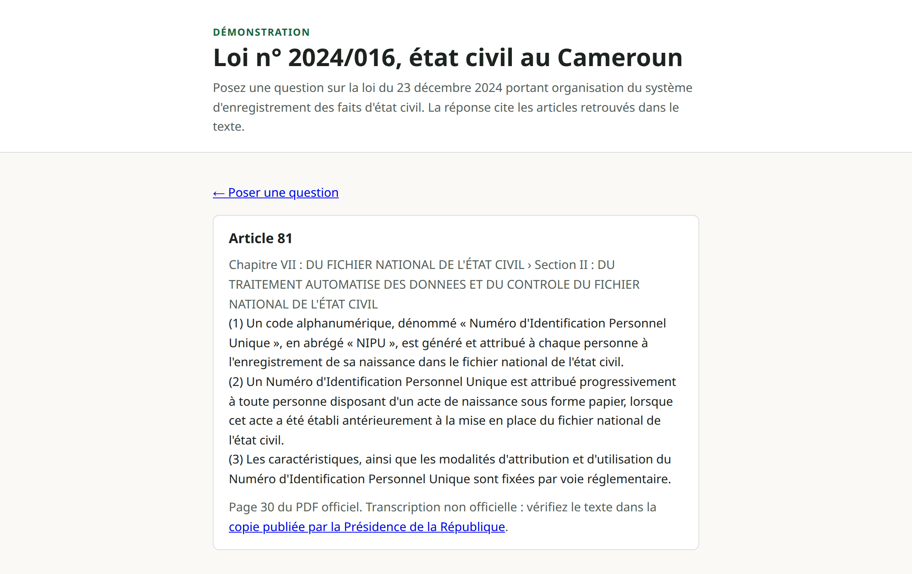

# RAG état civil — loi n° 2024/016

Démo d'un assistant de questions-réponses **avec citations d'articles** sur la loi n° 2024/016 du 23 décembre 2024 portant organisation du système d'enregistrement des faits d'état civil au Cameroun.

> **Outil de démonstration, ne remplace pas un avis juridique.** Seul le texte publié au Journal Officiel fait foi. Le texte interrogé est une transcription non officielle de la [copie publiée par la Présidence de la République](https://prc.cm/fr/multimedia/documents/10257-loi-n-2024-016-du-23-12-2024-web).

**Projet indépendant** : il n'a aucun lien avec un organisme public ni avec un employeur. Il est construit à partir du seul texte public de la loi, sans aucune donnée, code ni document interne.

## État du projet

| Élément                                                             | Statut                                         |
|---------------------------------------------------------------------|------------------------------------------------|
| Recherche des passages (vecteurs, BM25, lookup, fusion RRF)         | ✅ Terminé                                     |
| Génération de réponses avec citations d'articles et refus           | ✅ Terminé                                     |
| Interface web et API JSON                                           | ✅ Terminé                                     |
| Évaluation sur 21 questions de référence                            | ✅ Terminé                                     |
| Améliorer les 6 réponses jugées partielles (voir « Évaluation »)    | 🔜 À faire                                     |
| Démo en ligne                                                       | 🔜 À faire (pour l'instant, installation locale) |
| Version anglaise du README                                          | 🔜 À faire                                     |

## Aperçu

[](docs/screenshots/nipu-hd.png)

Un clic sur un article cité ouvre son texte exact et sa page dans le PDF officiel.

[](docs/screenshots/nipu-article-hd.png)

## Démarrage

Prérequis : [uv](https://docs.astral.sh/uv/) et Python 3.12.

### 1. Installer et configurer

```
cp .env.example .env
make install
```

Ouvrez ensuite `.env` et renseignez `GEMINI_API_KEY` avec une clé créée sur [Google AI Studio](https://aistudio.google.com/apikey). Le fournisseur par défaut est `LLM_PROVIDER=gemini` et le modèle par défaut `GEMINI_MODEL=gemini-3.5-flash-lite` ; vous pouvez changer `GEMINI_MODEL` dans `.env`.

La clé n'est utilisée que pour l'étape de génération de la réponse. La recherche des passages (embeddings, BM25) s'exécute entièrement en local. Ne versionnez jamais votre fichier `.env`.

### 2. Construire l'index (une seule fois)

```
make index      # calcule les embeddings et construit data/index (lent, une fois)
```

`make index` télécharge le modèle d'embeddings la première fois (environ 2,2 Go, stocké dans `.cache/models`) puis calcule un vecteur par passage. Sur un processeur sans carte graphique, comptez de quelques minutes à une vingtaine de minutes. L'index est un fichier généré, il n'est pas versionné ; il est à refaire si le texte ou le modèle change.

Les articles et passages (`data/processed/`) sont déjà versionnés : `make ingest` n'est pas nécessaire au premier lancement.

### 3. Lancer l'application

```
make run        # http://127.0.0.1:5000
```

Ouvrez l'adresse affichée et posez une question, par exemple « Dans quel délai déclarer une naissance ? ».

### Autres commandes

```
make ask q="dans quel délai déclarer une naissance ?"      # question complète en ligne de commande (nécessite la clé API)
make search q="dans quel délai déclarer une naissance ?"   # recherche seule, sans LLM, avec les scores
make check            # ruff + tests
make eval-retrieval   # évalue la recherche, rapport dans eval/results/retrieval.md
make eval-answers     # évalue les réponses générées sur les 21 questions de référence (nécessite la clé API)
make ingest           # régénère data/processed à partir de data/raw, seulement si vous modifiez data/raw
```

> **Windows** : `make` n'est pas installé par défaut. Utilisez WSL, ou lancez directement les commandes `uv run ...` définies dans le `Makefile`.

## Comment fonctionne la recherche

Une question passe par trois recherches, puis leurs résultats sont fusionnés :

| Recherche | Rôle                                                                                             |
|-----------|--------------------------------------------------------------------------------------------------|
| `vector`  | passages proches par le sens (embeddings `multilingual-e5-large`, exécutés en local)             |
| `bm25`    | passages partageant les mots rares de la question (BM25 écrit à la main, racinisation française) |
| `lookup`  | articles cités explicitement : « article 36 » renvoie toujours l'article 36                      |

La fusion (RRF) combine les **rangs** des deux premières recherches, pas leurs scores, qui ne sont pas comparables. `make search` affiche pour chaque passage l'article, qui l'a trouvé, le score de fusion (`rrf`), la similarité cosinus (`similarity`) et la page du PDF officiel.

Le score `rrf` ne sert qu'à ordonner les résultats d'une même question. La similarité, elle, permet de distinguer une question qui porte sur la loi d'une question hors sujet. Le seuil (`MIN_SIMILARITY`, 0,80 par défaut) vient de l'évaluation : la question dans le périmètre la plus éloignée est à 0,852, la question hors sujet la plus proche à 0,793. 0,80 ne refuse donc aucune question légitime de l'évaluation ; il évite seulement d'appeler le modèle pour les questions manifestement hors sujet, que le modèle refuserait de toute façon.

Le nombre de passages donnés au modèle (`RETRIEVAL_TOP_K`, 8 par défaut) vient de l'évaluation : avec 5 passages, une question en cascade comme « dans quel délai déclarer une naissance ? » perd l'article 13 (jugement déclaratif au-delà de 12 mois) ; avec 8, les articles 10, 12 et 13 sont tous présents (`make eval-retrieval`).

## Comment fonctionne la génération

Les 8 passages retenus sont transmis au modèle avec la question et une consigne : répondre uniquement à partir de ces passages, citer les articles utilisés, refuser si la réponse n'y est pas. Le modèle renvoie un objet JSON (statut, réponse, numéros d'articles). L'application vérifie que la réponse cite au moins un article, et uniquement des articles présents dans les passages fournis. Sinon, elle redemande une fois en expliquant le problème, puis refuse.

L'assistant refuse aussi, sans appeler le modèle, quand aucun passage n'est assez proche de la question (similarité inférieure à 0,80, sauf si un article est cité par son numéro).

Chaque article cité est un lien vers son texte exact et sa page dans le PDF officiel. **Cette vérification porte sur les articles cités, pas sur chaque phrase** : lisez toujours les articles en entier.

En résumé, il y a quatre motifs de refus : aucun passage trouvé, similarité sous le seuil, refus du modèle lui-même, citations invalides après une nouvelle tentative. Une panne du modèle n'est pas un refus : la page affiche « service indisponible ».

## Évaluation

Un jeu de 21 questions de référence (recherche directe d'un article, questions en cascade sur plusieurs articles, formulations familières, questions hors sujet ou hors de la loi) mesure si le bon article est retrouvé et si la réponse est correcte. Sur ce jeu, l'assistant n'a inventé aucune réponse ; 6 réponses sont jugées partielles. Le détail est dans [eval/results.md](eval/results.md).

## Composants interchangeables

`Embedder`, `VectorIndex` et `LLMProvider` sont des interfaces :

- **Embeddings** : l'implémentation se choisit avec la variable `EMBEDDER`, la seule valeur disponible est `fastembed`. Changer de modèle d'embeddings impose de refaire l'index ; une incohérence est détectée et signalée au chargement.
- **Index vectoriel** : l'implémentation actuelle est `NumpyIndex` (NumPy). D'autres implémentations, comme Chroma ou pgvector, pourraient être ajoutées derrière la même interface.
- **Modèle de langage** : ajouter un fournisseur demande une classe et une ligne dans `llm/registry.py`. Seul Gemini est implémenté pour l'instant.

## API

| Route                   | Rôle                                                              |
|-------------------------|-------------------------------------------------------------------|
| `GET /`                 | page web                                                          |
| `POST /ask`             | question depuis la page (HTMX)                                    |
| `POST /api/ask`         | question en JSON : `{"question": "…"}`                            |
| `GET /articles/<n>`     | texte de l'article n et sa page dans le PDF officiel              |
| `GET /api/articles/<n>` | même contenu en JSON                                              |
| `GET /health`           | état de l'application, sans appel au modèle                       |

```
curl -X POST http://127.0.0.1:5000/api/ask \
  -H "Content-Type: application/json" \
  -d '{"question": "Dans quel délai déclarer une naissance ?"}'
```

## Captures d'écran

Les captures de `docs/screenshots/` sont produites par `scripts/capture_screenshot.py`, avec l'application lancée (`make run`) dans un autre terminal :

```
uv run python scripts/capture_screenshot.py -q "Qu'est-ce que le NIPU ?" --name nipu
```

Le script pose la question dans la page, attend la réponse et ses citations, puis écrit `<n>-hd.png` (en-tête, formulaire et réponse, en ×2) et `<n>-linkedin.png` (titre et réponse, 1200x627 px). Il n'écrit rien si le modèle de langage échoue ou si l'assistant refuse de répondre.

Avec l'option `--open-citation`, le script clique ensuite sur une citation et capture seulement la page de l'article (`<n>-article-hd.png`, sans version LinkedIn). Par défaut c'est la première citation ; `--citation 2` ouvre la deuxième. La capture de l'article 81 a été produite ainsi :

```
uv run python scripts/capture_screenshot.py -q "Qu'est-ce que le NIPU ?" --name nipu --open-citation --citation 2
```

Comme le modèle ne cite pas toujours les articles dans le même ordre, vérifiez le numéro de l'article sur l'image. Le script n'écrit rien si la réponse cite moins d'articles que demandé ou si le lien ne mène pas à la page de l'article.

## Structure

```
data/raw/           texte de la loi (transcription) et fiche de source
data/processed/     articles et passages (versionnés, régénérables avec `make ingest`)
data/index/         index vectoriel généré (`make index`, non versionné)
docs/               vérification de la transcription, captures d'écran
eval/               questions d'évaluation et rapports
scripts/            capture d'écran de l'application (Playwright)
src/rag_etat_civil/
  ingestion/        texte -> articles -> passages
  embeddings/       interface Embedder, implémentation fastembed, registre
  retrieval/        index, BM25, fusion, retriever, commandes index et search
  answering/        génération de la réponse, vérification des citations, refus
  llm/              interface LLMProvider, implémentation Gemini, registre
  evaluation/       code de l'évaluation
  web/              application Flask
tests/              tests
```

## Licence

MIT, voir [LICENSE](LICENSE). Le texte de la loi est un acte officiel, voir `data/raw/SOURCE.md`.