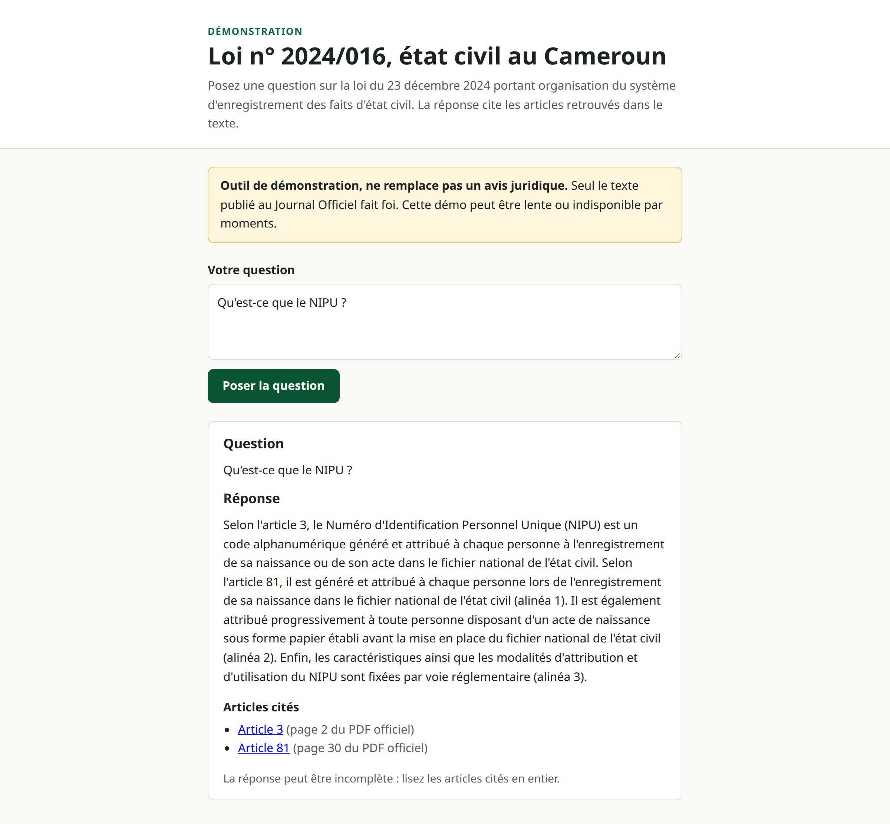

# RAG état civil — loi n° 2024/016

Démo d'un assistant de questions-réponses **avec citations d'articles** sur la loi n° 2024/016 du
23 décembre 2024 portant organisation du système d'enregistrement des faits d'état civil au Cameroun.

> **Outil de démonstration, ne remplace pas un avis juridique.** Seul le texte publié au Journal
> Officiel fait foi. Le texte interrogé est une transcription non officielle de la
> [copie publiée par la Présidence de la République](https://prc.cm/fr/multimedia/documents/10257-loi-n-2024-016-du-23-12-2024-web).

**Projet indépendant** : il n'a aucun lien avec un organisme public ni avec un employeur. Il est
construit à partir du seul texte public de la loi, sans aucune donnée, code ni document interne.

État : en construction. La recherche des passages de la loi fonctionne (voir ci-dessous) ;
la génération des réponses, l'API et l'interface complète arrivent aux étapes suivantes.

## Aperçu



## Démarrage

Prérequis : [uv](https://docs.astral.sh/uv/) et Python 3.12.

```bash
cp .env.example .env
make install
make run        # http://127.0.0.1:5000
make check      # ruff + tests
make ingest     # rebuild data/processed from data/raw
make index      # compute the embeddings and build data/index (slow, once)
make search q="dans quel délai déclarer une naissance ?"
```

`make index` télécharge le modèle d'embeddings la première fois (environ 2,2 Go, stocké dans
`.cache/models`) puis calcule un vecteur par passage. Sur un processeur sans carte graphique,
comptez de quelques minutes à une vingtaine de minutes. L'index est un fichier généré, il n'est
pas versionné ; il est à refaire si le texte ou le modèle change.

Les captures de `docs/screenshots/` sont produites par `scripts/capture_screenshot.py`, avec
l'application lancée (`make run`) dans un autre terminal :

```bash
uv run python scripts/capture_screenshot.py -q "Qu'est-ce que le NIPU ?" --name nipu
```

Le script pose la question dans la page, attend la réponse et ses citations, puis écrit
`<name>-hd.png` (en-tête, formulaire et réponse, en ×2) et `<name>-linkedin.png` (titre et
réponse, 1200x627 px). Il n'écrit rien si le modèle de langage échoue ou si l'assistant refuse de
répondre.

## Comment fonctionne la recherche

Une question passe par trois recherches, puis leurs résultats sont fusionnés :

| Recherche | Rôle |
|---|---|
| `vector` | passages proches par le sens (embeddings `multilingual-e5-large`, exécutés en local) |
| `bm25` | passages partageant les mots rares de la question (BM25 écrit à la main, racinisation française) |
| `lookup` | articles cités explicitement : « article 36 » renvoie toujours l'article 36 |

La fusion (RRF) combine les **rangs** des deux premières recherches, pas leurs scores, qui ne sont
pas comparables. `make search` affiche pour chaque passage l'article, qui l'a trouvé, le score de
fusion (`rrf`), la similarité cosinus (`similarity`) et la page du PDF officiel.

Le score `rrf` ne sert qu'à ordonner les résultats d'une même question. La similarité, elle,
permet de distinguer une question qui porte sur la loi d'une question hors sujet. Le seuil
(`MIN_SIMILARITY`, 0,80 par défaut) vient de l'évaluation : la question dans le périmètre la plus
éloignée est à 0,852, la question hors sujet la plus proche à 0,793. 0,80 ne refuse donc aucune
question légitime de l'évaluation ; il évite seulement d'appeler le modèle pour les questions
manifestement hors sujet, que le modèle refuserait de toute façon.

Le nombre de passages donnés au modèle (`RETRIEVAL_TOP_K`, 8 par défaut) vient de l'évaluation :
avec 5 passages, une question en cascade comme « dans quel délai déclarer une naissance ? » perd
l'article 13 (jugement déclaratif au-delà de 12 mois) ; avec 8, les articles 10, 12 et 13 sont tous
présents (`make eval-retrieval`, rapport dans `eval/results/retrieval.md`).

Les composants sont interchangeables : `Embedder` et `VectorIndex` sont des interfaces, le choix se
fait par variable d'environnement (voir `.env.example`). Changer de modèle d'embeddings impose de
refaire l'index ; une incohérence est détectée et signalée au chargement.

## Structure

```
data/raw/           texte de la loi (transcription) et fiche de source
data/processed/     articles et passages générés (`make ingest`)
data/index/         index vectoriel généré (`make index`, non versionné)
docs/               vérification de la transcription, captures d'écran
scripts/            capture d'écran de l'application (Playwright)
src/rag_etat_civil/
  ingestion/        texte -> articles -> passages
  embeddings/       interface Embedder, implémentation fastembed, registre
  retrieval/        index, BM25, fusion, retriever, commandes index et search
  web/              application Flask
tests/              tests
```

## Licence

MIT, voir [LICENSE](LICENSE). Le texte de la loi est un acte officiel, voir `data/raw/SOURCE.md`.
